# A10 – Lead Screw Translating System

## Objective

The objective of this project is to design a mechanically driven benchtop tensile tester capable of applying up to 2 kN axial tensile loads with a controllable crosshead speed from 1 to 50 mm/min. The project will be done as a team and will be broken into two parts.

In this part of the project, we will be selecting the identical leadscrews, nut, and flange based on our requirements found from calculations. Then we will parametrically design and model the crosshead before assembling all the components in CAD. The leadscrews must be a minimum of 18 inches, we must maintain a safety factor of 4, and the maximum crosshead deflection should be no more than 0.10 mm.

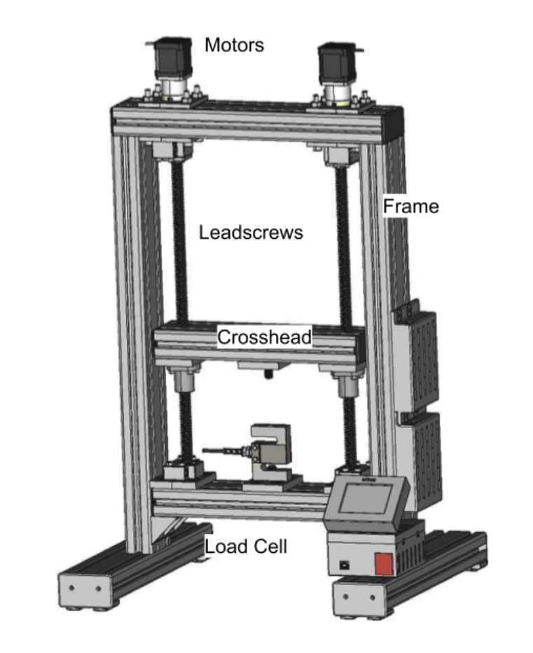

## Leadscrew Diameter – Christopher Clade

### Minimum Leadscrew Diameter

We began solving for the minimum diameter of the leadscrew by listing all our knowns and unknowns before sketching a free body diagram.

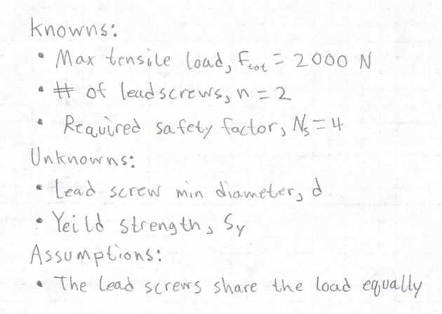

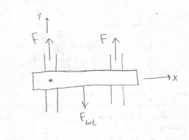

In order to find an appropriate yield strength to use for our calculations, we searched on Roton’s website to find what materials their leadscrews are made of. [This part of their website](https://www.roton.com/products/acme-lead-screws-nuts/general-information/) lists the materials they use. We arbitrarily chose to use their Stainless Steel, which they list as 304 type stainless steel. Because of this decision, we are limiting ourselves to using a leadscrew made of 304 type stainless steel. However, we do not think we will struggle to find a suitable leadscrew due to the large selection available on the website.

We found the yield strength for 304 type stainless steel from SolidWorks.

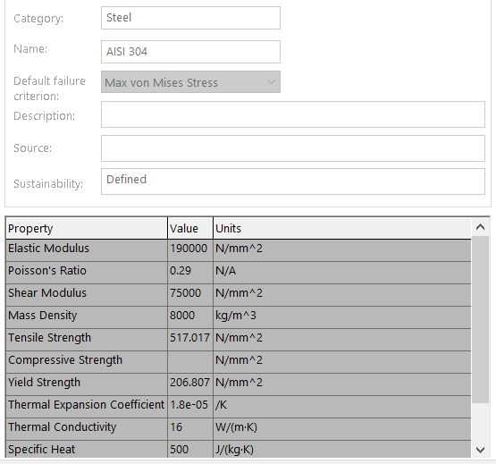

Then, we used the equation for our allowable stress to symbolically solve for the minimum diameter and found it to be 4.96 mm or 0.1953 in.

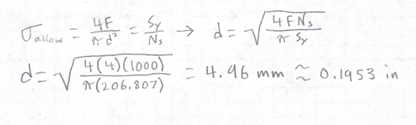

Based on this minimum diameter, we found a good candidate for our [leadscrew from Roton](https://www.roton.com/product/acme-stainless-steel-screw-right-59488/). Since we are only picking a leadscrew that fulfills our requirements rather than creating our own, we decided to use this leadscrew as a guide for our calculations moving forward to make sure the design specifications were attainable.

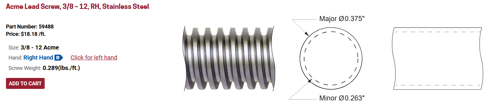

### Range of Rotational Speed

Using the given linear speed, we were able to symbolically solve for the possible range of rotational speed. We began by listing all our knowns, unknowns, and sketching a FBD.

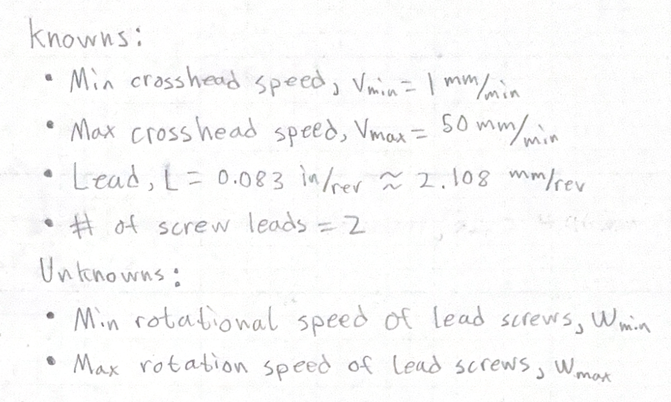

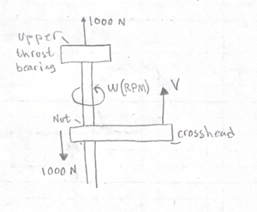

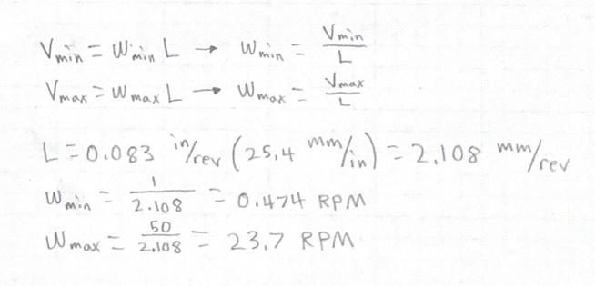

### Torque at the Maximum Load

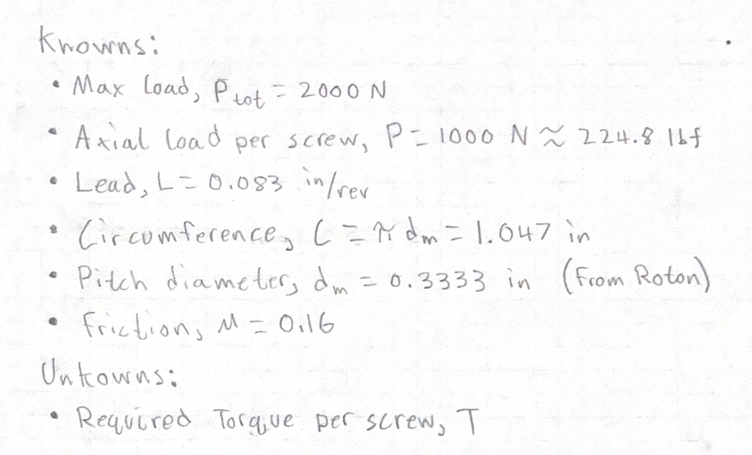

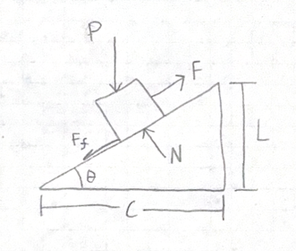

After listing all our knowns, unknowns, and drawing a free body diagram, we were able to solve symbolically for the torque before plugging in our values.

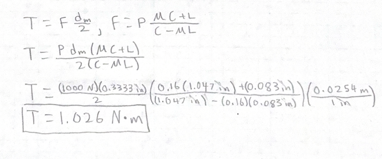

The 3/8 – 12 Acme lead screw worked for all our calculations, so we were able to move on to selecting a nut and flange.

## Nut and Flange Selection – Sami Ali

I selected McMaster-Carr 95072A108, a 673 bronze nut with an internal 3/8–12 right-hand Acme thread, for the Roton 59488 leadscrew. The nut’s external 9/16–18 mounting thread connects to the McMaster-Carr 95082A641 steel flange. The two interfaces have different pitches because they connect different components. 

### Knowns and Unknowns

| **Quantity**                      | **Value**              |
|-----------------------------------|------------------------|
| Axial force per nut F             | 2,000 / 2 = 1,000 N    |
| Required safety factor N          | 4                      |
| Internal Acme pitch p             | 25.4 / 12 = 2.1167 mm  |
| Nominal thread diameter d         | 9.525 mm               |
| Assumed effective engagement Lₑ   | 15.875 mm              |
| Assumed bronze yield strength Sᵧ  | 276 MPa                |

I solved for the engaged turns, estimated mean diameter, thread bending stress, allowable stress, and actual bending safety factor. The model assumes equal load sharing between the nuts and among the engaged thread turns. 

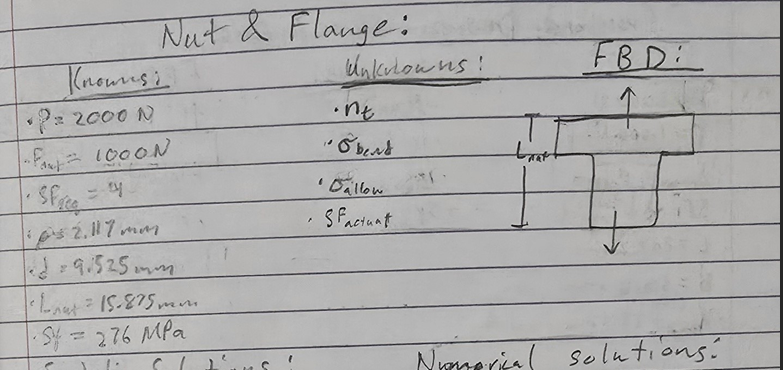

### Symbolic and numerical solution

nₑ = Lₑ / p = 15.875 / 2.1167 = 7.5 nominal engaged turns 

dₘ ≈ d − p / 2 = 9.525 − 2.1167 / 2 = 8.4667 mm 

σbend = 6F / (nₑπdₘp) = 6(1,000) / \[7.5π(8.4667)(2.1167)\] = 14.2 MPa 

σallow = Sᵧ / N = 276 / 4 = 69.0 MPa 

Nactual = Sᵧ / σbend = 276 / 14.2 = 19.4 

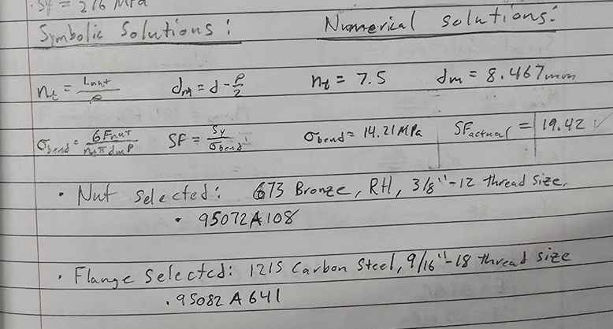

Using the simplified mean-diameter bending equation from the reference example, the calculated safety factor exceeds 4. I assumed full engagement over the nut’s overall length and used C67300 H50 reference properties. The nut’s actual effective engagement and temper require confirmation, so this is a preliminary result.

## Crosshead Design – Sami Ali

I treated the crosshead as a simply supported beam with the grip at midspan. The two nut centers support the crosshead 203.2 mm apart. The 2,000 N specimen load produces a 1,000 N reaction at each support. I extended the bar beyond the supports to provide room for the flange mounting features. 

| **Quantity**                  | **Value**     |
|-------------------------------|---------------|
| Overall length                | 254 mm        |
| Width b                       | 50.8 mm       |
| Vertical thickness h          | 25.4 mm       |
| Support span L                | 203.2 mm      |
| Maximum center load P         | 2,000 N       |
| Selected SOLIDWORKS material  | 6061-T6 (SS)  |
| Yield strength Sᵧ used        | 275 MPa       |
| Elastic modulus E used        | 69,000 MPa    |
| Required safety factor        | 4             |
| Maximum allowable deflection  | 0.10 mm       |

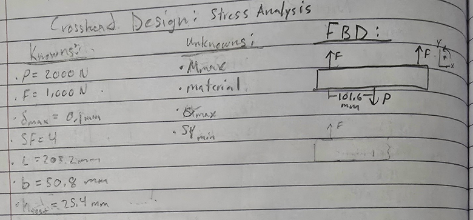

### Bending strength

Mmax = PL / 4 = 2,000(203.2) / 4 = 101,600 N·mm 

I = bh³ / 12 = 50.8(25.4)³ / 12 = 69,371.9 mm⁴ 

c = h / 2 = 12.7 mm 

σmax = Mmax c / I = 101,600(12.7) / 69,371.9 = 18.6 MPa 

Sᵧ,min = 4σmax = 74.4 MPa 

Nactual = Sᵧ / σmax = 275 / 18.6 = 14.8 

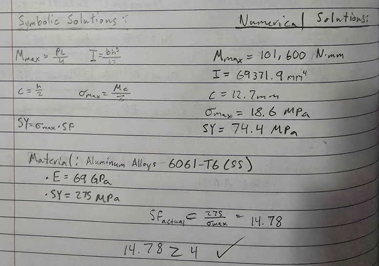

### Deflection

Emin = PL³ / (48Iδallow) = 50,394 MPa = 50.4 GPa 

δmax = 2,000(203.2)³ / \[48(69,000)(69,371.9)\] = 0.073 mm 

The calculated bending safety factor is 14.8, and the center deflection is 0.073 mm. Both satisfy the preliminary requirements. These results use a solid rectangular beam section. Local effects at the mounting holes and grip interface require evaluation in the final geometry. 

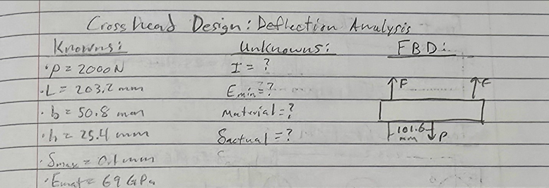

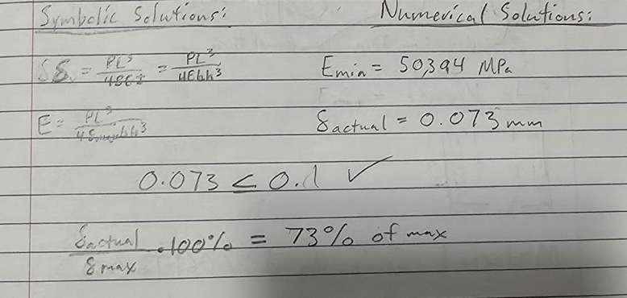

### Paper sketch

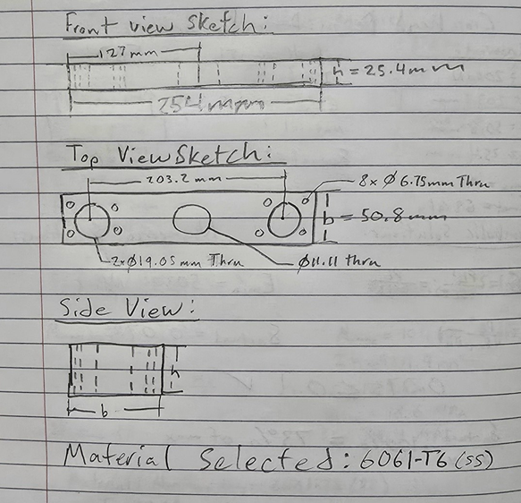

## Bill of Materials

| Item Number | Quantity | Name                                       | Cost/Item | Purchase Link                                                           |
|-------------|----------|--------------------------------------------|-----------|-------------------------------------------------------------------------|
| 1           | 2        | Acme Lead Screw, 3/8 – 12, Stainless Steel | \$54.54   | <https://www.roton.com/product/acme-stainless-steel-screw-right-59488/> |
| 2           | 2        | Leadscrew nut                              | \$32.18   | <https://www.mcmaster.com/95072A108/>                                   |
| 3           | 2        | Flange                                     | \$37.06   | <https://www.mcmaster.com/95082A641/>                                   |
| 4           | 4        | T-Slot Framing: 92 cm                      | \$51.52   | <https://www.mcmaster.com/5537T904/>                                    |
| 5           | 2        | T-Slot Framing: 140 cm                     | \$78.40   | <https://www.mcmaster.com/5537T904/>                                    |
|             |          |                                            |           |                                                                         |
|             |          | Total Cost                                 | \$610.44  |                                                                         |

The total cost of the material at this point will be approximately \$610.44. The custom crosshead design is not included in this parts total.

## CAD Assembly – Sami Ali

I modeled the crosshead and completed the tensile tester assembly in SOLIDWORKS using the part files downloaded from McMaster-Carr and Roton. The crosshead dimensions followed the hand calculations, and I used concentric and coincident mates to position and align the components. 

Concentric mates aligned the leadscrews with the nut bores and positioned cylindrical mounting features. Coincident mates placed the mating faces together. The crosshead connects to the nuts through the mounting flanges, while the frame establishes the surrounding assembly layout. 

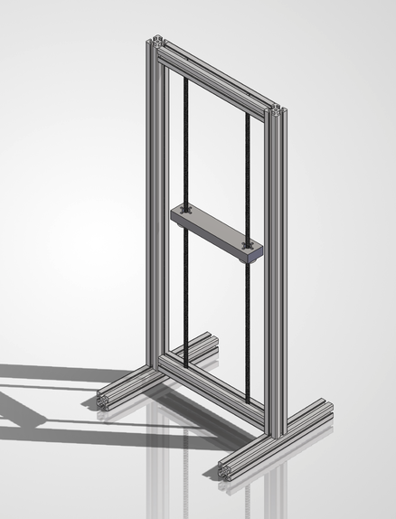

## 2157 Students

### Crosshead FEA – Christopher Clade

We ran FEA on our crosshead to evaluate its strength and to optimize the geometry. A 2 kN load was applied where it would represent the axial tension through the grips into the crosshead. Additionally, the surface interface of the mounting flange and nut on the crosshead was set as fixed geometry.

We started by running the FEA with a coarse mesh, then medium mesh, then fine mesh to perform a mesh convergence check

#### Coarse Mesh

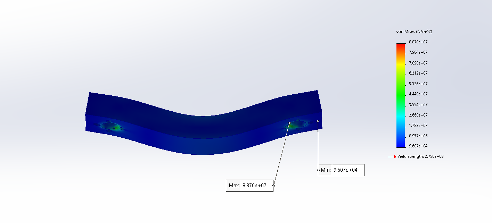

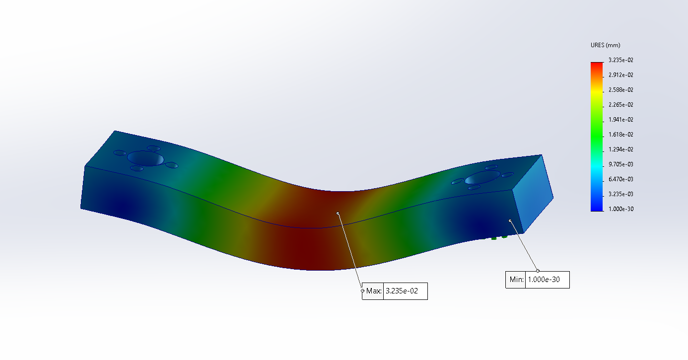

#### Medium mesh

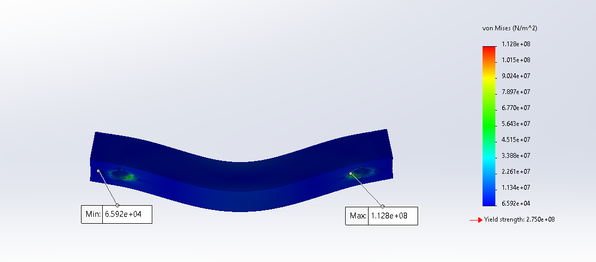

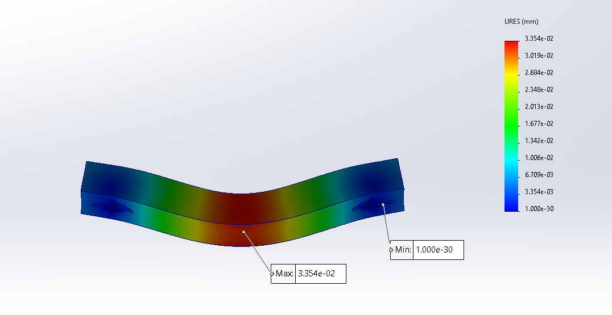

#### Fine mesh

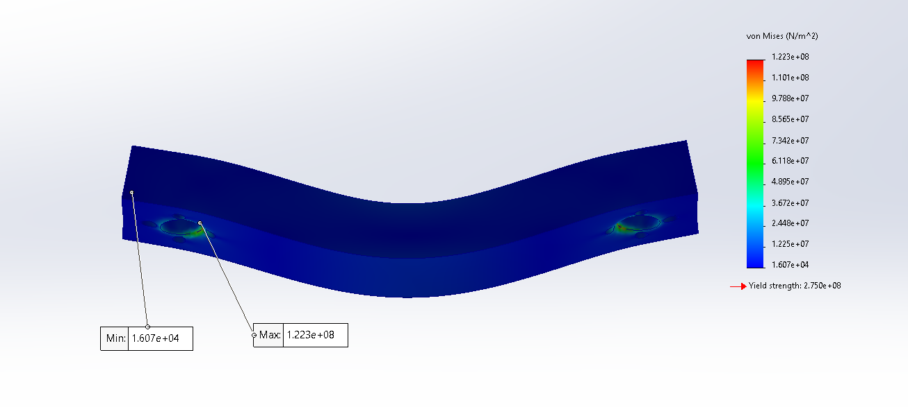

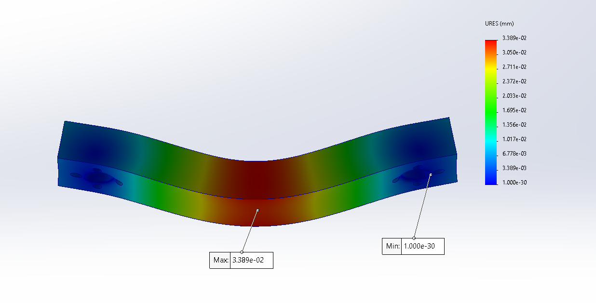

#### Results

| **Metric**                            | **Coarse Mesh**                  | **Medium Mesh**                   | **Fine Mesh**                     |
|---------------------------------------|----------------------------------|-----------------------------------|-----------------------------------|
| Maximum von Mises stress and location | 88.7 MPa at flange mounting hole | 112.8 MPa at flange mounting hole | 122.3 MPa at flange mounting hole |
| Maximum deflection                    | 0.03235 mm                       | 0.03354 mm                        | 0.03389 mm                        |
| Factor of Safety                      | 3.10                             | 2.44                              | 2.25                              |

At each mesh the maximum deflection falls safely under the maximum allowed 0.10 mm. However, the safety factor does not meet the requirement of 4. Additionally, the holes for the nuts and lead screws turn upwards a lot more than should be expected or allowed.

After looking over the FEA simulation, we realized the fixed geometry was not applied correctly. It was only applied at the diameter of the leadscrew hole, which cause there to be a greater deflection and higher stress concentrations as seen in the images. After fixing the fixed geometry to be in the correct position, we ran FEA on the crosshead again with a fine mesh.

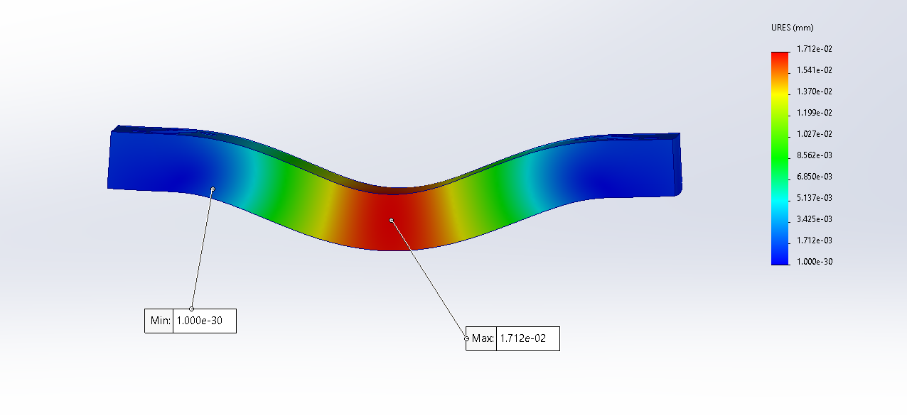

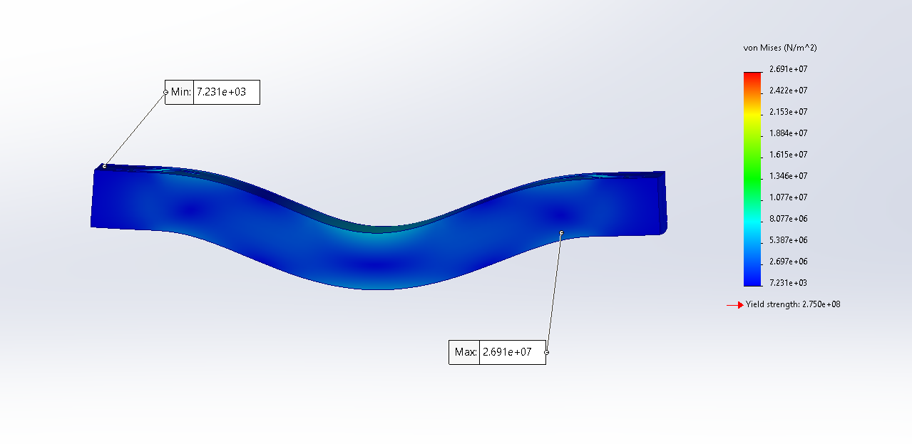

|                       | **Original values** | **Revised values** | **Requirement** |
|-----------------------|---------------------|--------------------|-----------------|
| Peak von Mises stress | 122.3 MPa           | 26.91 MPa          | ≤ 68.75 MPa     |
| Factor of Safety      | 2.25                | 10.22              | ≥ 4.0           |
| Maximum displacement  | 0.03389 mm          | 0.01712 mm         | ≤ 0.10 mm       |

With the fixed geometry in the correct position, the crosshead now greatly exceeded all the design requirements.

#### Proposed Design Changes

Since the minimum requirements were exceeded, we decided the best way to optimize it would be to remove material, making the crosshead cheaper and lighter. To do this, a 20 mm fillet was added at each corner and on either side of the path of the axial tension path 3 slots were cut.

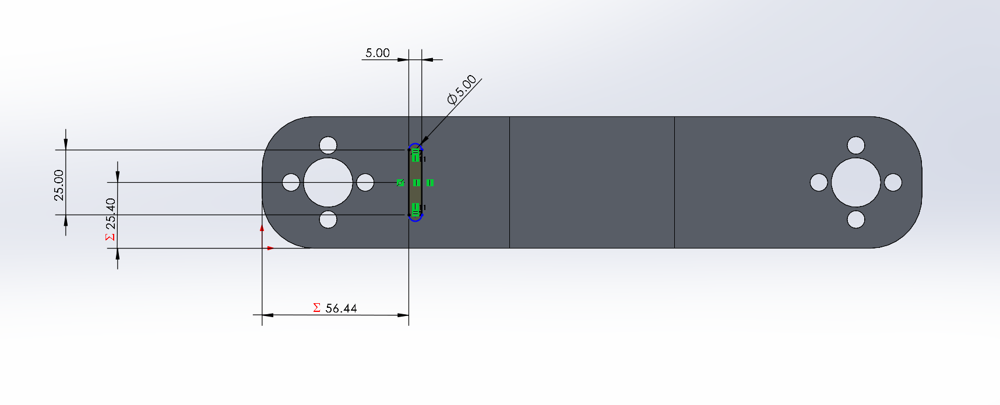

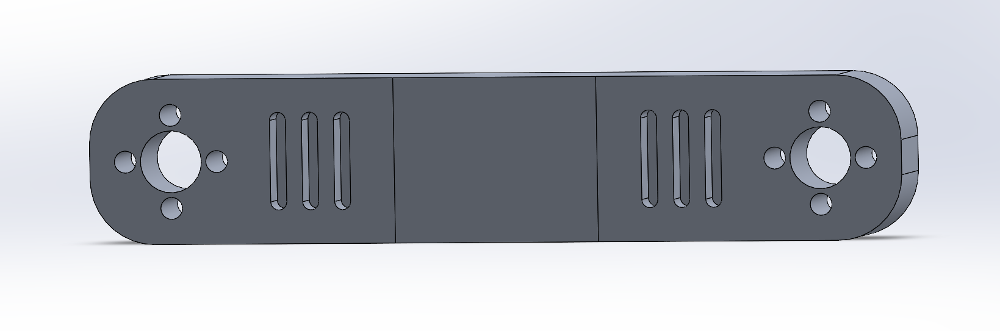

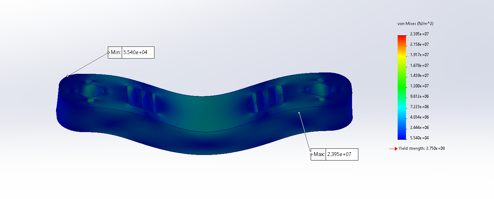

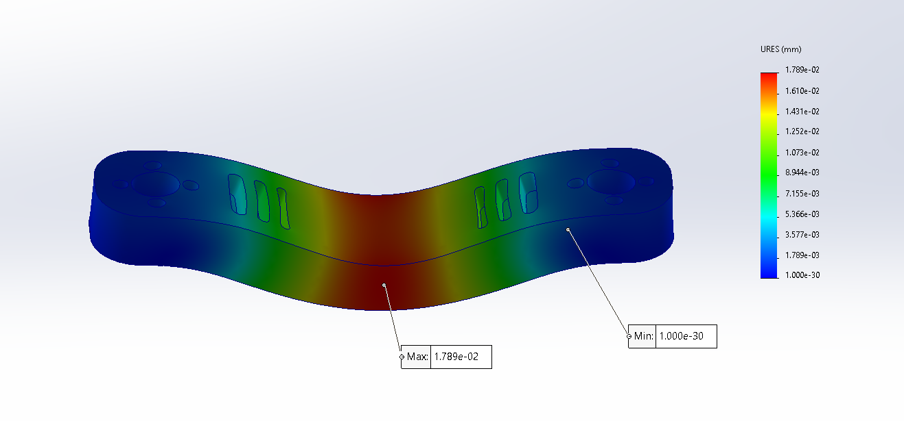

#### Results

|                          | **Unrevised geometry** | **Revised geometry** | **Percent change** |
|--------------------------|------------------------|----------------------|--------------------|
| Maximum von Mises stress | 26.91 MPa              | 23.95 MPa            | -11.0%             |
| Max displacement         | 0.01712 mm             | 0.01789 mm           | +4.5%              |
| Factor safety            | 10.22                  | 11.48                | +12.3%             |
| Mass                     | 826.175 g              | 779.196 g            | -5.69%             |

With the revised geometry SolidWorks measured a -5.69% decrease in mass while the rest of the requirements were still met. The slots actually allowed the stress to be distributed more evenly, causing a total 11.0% stress decrease. The maximum deflection did increase by 4.5% from the previous design, but it remains well under 0.10 mm.

Original and revised geometry mass properties from SolidWorks:

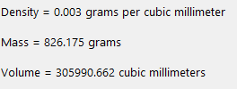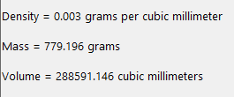

## CAD Drawing – Sami Ali

I created a CAD drawing of the crosshead to communicate its geometry and mounting features. The drawing accompanies the model and paper sketch as part of my design work.

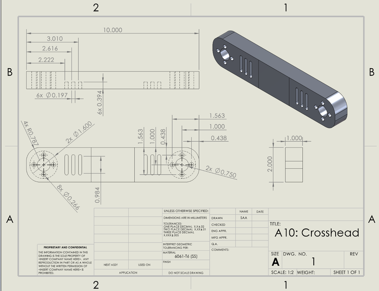

## Lessons Learned

### Engineering Lessons Learned by Sami Ali

I learned how to use thread compatibility to select the nut and flange. The Acme thread inside the nut must match the leadscrew, while the mounting thread outside the nut must match the flange. Working with these two interfaces helped me understand why the nut can have 12 threads per inch internally and 18 threads per inch externally. 

The crosshead calculations showed me how strength and stiffness affect material selection. The 6061-T6 material met the required bending safety factor, but I also had to calculate deflection to verify the 0.10 mm limit. Using the same dimensions and material properties in the hand calculations and CAD model made the design more consistent. 

I also learned to distinguish the support span from the overall bar length. The bending and deflection equations used the 203.2 mm distance between the nut centers, while the 254 mm overall length provided space beyond the supports for the flange mounting features. 

The frame alignment difficulty showed me that the orientation of imported parts affects assembly mating. A slight angle made the frame more difficult to position, so selecting appropriate faces and checking component orientation became important parts of assembling the model. 

### Lessons Learned – Christopher Clade

This assignment taught me that working in a team comes with its own challenges. I had assumed that the assignment would be easier with more people working on it, and that is not completely false. However, it was difficult creating an effective workflow and the sharing of files became cluttered and unorganized. Additionally, we used different versions of SolidWorks so I could not open CAD files Sami had made. This was very frustrating and led to a lot more work needing to be done.

Know I know how important it is to spend extra time planning at the beginning of a project in order to stay organized throughout the entirety of the time working on it.

## Time Spent

Total time spent on this assignment was approximately 15 hours.

## CAD Files

ZIP folder with all files –

## Additional References

The references below support the component selection and material assumptions. The nut calculation uses the simplified bending equation shown in the peer reference example. 

[**Roton 59488 leadscrew**](https://www.roton.com/product/acme-stainless-steel-screw-right-59488/) 

[**McMaster-Carr 95072A108 bronze nut**](https://www.mcmaster.com/95072A108/) 

[**McMaster-Carr 95082A641 steel mounting flange**](https://www.mcmaster.com/95082A641/) 

[**Copper Development Association C67300 material properties**](https://alloys.copper.org/alloy/C67300) 

[**SOLIDWORKS Simulation material reference for 6061-T6 SS**](https://www.solidworks.com/sw/docs/SIM_HOTD_WB_2011_ENG.pdf) 
